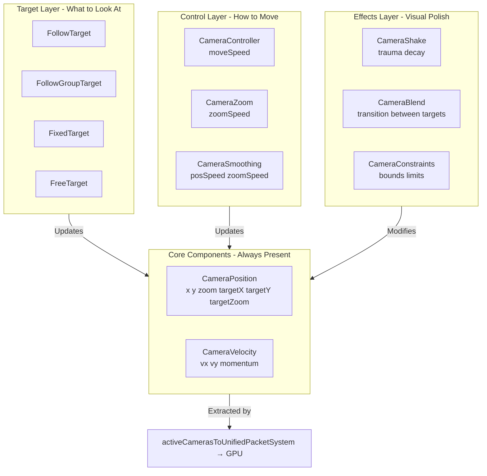

# Camera System - Composable Architecture

## Overview

The camera system provides a flexible, composable component-based architecture for 2D camera control. Built with **performance-first** design using TypedData for zero-GC hot paths.

## Architecture

### Three-Layer Design



> **Note:** Canvas rendering via `Camera.transformCanvas()` and `ecs_camera_flutter` is deprecated.
> All rendering goes through the GPU pipeline: ECS camera components → UnifiedRenderPacket → wgpu.
> Scene-description-based games use `SceneCamera` which bridges into these components automatically.

### Design Principles

1. **Target components are mutually exclusive** - entity can only have one (`FollowTarget` OR `FixedTarget`)
2. **Control/Effects are composable** - can combine multiple (`Controller` + `Zoom` + `Smoothing` + `Shake`)
3. **All movement goes through `CameraPosition`** - single source of truth
4. **Constraints applied last** - all systems write unconstrained, constraint system clamps
5. **TypedData for hot path** - `Position`/`Velocity` use extension components for zero-GC

## Components

### Target Layer (Mutually Exclusive)

#### `FollowTarget`

Follow a single entity with optional offset and dead zone.

```dart
final (ext, _) = world.getEntity(cameraEntity);
ext.insert(FollowTarget(
  playerEntity,
  offset: Offset(0, -50), // Lead shot above player
  deadZone: 100.0, // Don't move if target within 100px
));
```

#### `FollowGroupTarget`

Follow multiple entities (average or bounds-fitting).

```dart
ext.insert(FollowGroupTarget(
  [player1, player2, player3],
  mode: FollowGroupMode.average, // or fitBounds
  padding: 100.0, // Padding for fitBounds mode
));
```

#### `FixedTarget`

Fixed world position (strategy games, cutscenes).

```dart
ext.insert(FixedTarget(500.0, 300.0));
```

#### `FreeTarget`

Free-moving camera (controlled by input).

```dart
ext.insert(FreeTarget()); // Default for pan/zoom cameras
```

### Control Layer (Composable)

#### `CameraController`

Movement speed for input-based movement.

```dart
ext.insert(CameraController(
  moveSpeed: 200.0, // pixels per second
));
```

**Note**: Damping is controlled by `CameraVelocity.damping`, not `CameraController`.

#### `CameraZoom`

Zoom speed multiplier for input-based zoom operations.

```dart
ext.insert(CameraZoom(
  zoomSpeed: 1.0, // Multiplier for zoom input
));
```

**Note**: Zoom limits (`minZoom`/`maxZoom`) are controlled by `CameraConstraints`, not `CameraZoom`.

#### `CameraSmoothing`

Smooth interpolation to target position/zoom.

```dart
ext.insert(CameraSmoothing(
  positionSpeed: 5.0, // Higher = faster following
  zoomSpeed: 3.0, // Higher = faster zoom changes
));
```

### Effects Layer (Composable)

#### `CameraShake`

Screen shake effects (TypedData extension component).

```dart
final shake = ext.toExtension()
    .getOrCreate<CameraShakeComponent, CameraShake>();
shake.decay = 0.8; // Decay rate (0.0-1.0)
shake.addShake(5.0, 5.0); // Trigger shake
```

#### `CameraBlend`

Smooth transitions between camera targets.

```dart
ext.insert(CameraBlend(
  fromTarget: FreeTarget(),
  toTarget: FollowTarget(playerEntity),
  duration: Duration(seconds: 1),
  curve: Curves.easeInOut,
));
// Automatically removes itself when complete
```

#### `CameraConstraints`

Boundary limits for position and zoom. **This is the single source of truth for zoom limits.**

All zoom systems (`genericCameraZoomSystem`, `scrollZoomSystem`, etc.) respect these limits.
If `CameraConstraints` is not present, systems fall back to default limits (0.1 to 10.0).

```dart
ext.insert(CameraConstraints(
  minX: 0.0,
  maxX: 1000.0,
  minY: 0.0,
  maxY: 800.0,
  minZoom: 0.5,
  maxZoom: 3.0,
));
```

### Core Components (Always Present)

#### `CameraComponent`

Marker component identifying an entity as a camera. Required for all camera entities.

```dart
ext.insert(CameraComponent(
  isActive: true, // Whether camera is active
  priority: 0, // Rendering order (higher = first)
  cullingPadding: 100.0, // Padding for entity culling bounds (world units)
));
```

**Fields:**
- `isActive`: Whether this camera is currently active (only active cameras are used for rendering)
- `priority`: Rendering order priority (higher priority cameras render first)
- `cullingPadding`: Padding added to view bounds for entity culling (default: 100.0). Larger values include more entities outside the viewport for smoother rendering.

#### `CameraPosition` (Extension Component)

Current position, target position, and zoom levels. Uses TypedData for zero-GC.

```dart
final pos = ext.toExtension()
    .getOrCreate<CameraPositionComponent, CameraPosition>();
pos.setTarget(100.0, 200.0); // Set target position
pos.targetZoom = 2.0; // Set target zoom
```

#### `CameraVelocity` (Extension Component)

Velocity for momentum-based movement. Uses TypedData for zero-GC.

```dart
final vel = ext.toExtension()
    .getOrCreate<CameraVelocityComponent, CameraVelocity>();
vel.dx = 100.0; // Set velocity
vel.damping = 0.95; // Damping factor
```

## Common Use Cases

### Platformer Follow Camera

```dart
final camera = world.entities.create();
final (ext, _) = world.getEntity(camera);
world.spawnBundle(
  camera,
  ComponentBundle.fromLists(
    [
      CameraComponent(),
      FollowTarget(playerEntity, offset: Offset(0, -100)),
      CameraSmoothing(positionSpeed: 8.0),
      CameraConstraints(minX: 0, maxX: 2000, minZoom: 1.0, maxZoom: 1.0),
    ],
    [
      (CameraPositionComponent, CameraPosition),
    ],
  ),
);
```

### RTS Free Camera

```dart
final camera = world.entities.create();
final (ext, _) = world.getEntity(camera);
world.spawnBundle(
  camera,
  ComponentBundle.fromLists(
    [
      CameraComponent(),
      FreeTarget(),
      CameraController(moveSpeed: 300.0),
      CameraZoom(minZoom: 0.5, maxZoom: 2.0),
      CameraSmoothing(positionSpeed: 5.0, zoomSpeed: 3.0),
      CameraConstraints(minX: 0, maxX: 5000, minY: 0, maxY: 5000),
    ],
    [
      (CameraPositionComponent, CameraPosition),
      (CameraVelocityComponent, CameraVelocity),
    ],
  ),
);
```

### Cutscene Camera

```dart
final camera = world.entities.create();
final (ext, _) = world.getEntity(camera);
world.spawnBundle(
  camera,
  ComponentBundle.fromLists(
    [
      CameraComponent(),
      FixedTarget(500.0, 300.0),
      CameraSmoothing(positionSpeed: 2.0), // Slow, cinematic
    ],
    [
      (CameraPositionComponent, CameraPosition),
    ],
  ),
);
```

### Blending Between Modes

```dart
// Switch from free camera to follow camera
final (ext, _) = world.getEntity(cameraEntity);
ext.insert(CameraBlend(
  fromTarget: FreeTarget(),
  toTarget: FollowTarget(playerEntity),
  duration: Duration(milliseconds: 500),
  curve: Curves.easeInOut,
));
// Blend component automatically removes itself when done
```

## System Execution Order

Camera systems run in the Input schedule in this order:

1. **Target Systems** (update target position)

   - `cameraFollowTargetSystem`
   - `cameraFollowGroupTargetSystem`
   - `cameraFixedTargetSystem`
   - `cameraBlendSystem`

2. **Control Systems** (apply input/movement)

   - `keyboardCameraControlSystem`
   - `cameraPanSystem`
   - `scrollZoomSystem`
   - `pinchInputSystem`

3. **Update Systems** (smooth and apply effects)

   - `cameraSmoothingSystem` (lerp to target)
   - `cameraPhysicsSystem` (apply velocity)
   - `cameraShakeSystem` (apply shake offset)

4. **Constraint System** (clamp values)
   - `cameraConstraintsSystem` (**ALWAYS LAST**)

## Performance Notes

- **Zero-GC hot path**: `CameraPosition`, `CameraVelocity`, and `CameraShake` use TypedData extension components
- **Query-based**: Systems use efficient ECS queries instead of sealed class hierarchies
- **Composable**: Add/remove components to enable/disable features without overhead
- **Constraints run once**: All movement is unconstrained, then clamped at the end

## Migration from Old Behaviors

The old behavior-based camera system has been replaced with a composable component-based system.

> **Note**: Old behavior-based APIs (FreeMoveBehavior, FollowEntityBehavior, FixedPositionBehavior)
> were removed in v2.0.0. Use component-based approach shown below.

**Old** (deprecated):

```dart
ext.insert(FollowEntityBehavior(targetEntity: playerEntity));
```

**New**:

```dart
ext.insert(FollowTarget(playerEntity));
```

**Old** (deprecated):

```dart
ext.insert(FreeMoveBehavior());
```

**New**:

```dart
ext.insert(FreeTarget());
ext.insert(CameraController()); // Optional: controls movement speed
```

**Old** (deprecated):

```dart
ext.insert(FixedPositionBehavior(x: 500, y: 300));
```

**New**:

```dart
ext.insert(FixedTarget(500, 300));
```

## API Reference

See individual component files for detailed API documentation:

- `components/camera_target_components.dart`
- `components/camera_control_components.dart`
- `components/camera_blend_component.dart`
- `components/camera_constraints.dart`
- `components/camera_position_component.dart`
- `components/camera_velocity_component.dart`
- `components/camera_shake_component.dart`
